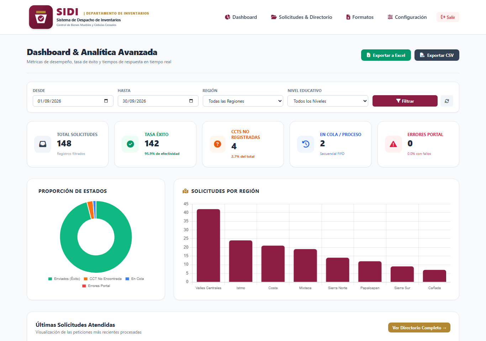

# SIDI - Sistema de Despacho de Inventarios Escolares (IEEPO)

SIDI es una solución web full-stack y resiliente desarrollada en Python 3.12 + FastAPI diseñada para automatizar la solicitud, extracción y despacho electrónico de constancias de inventario escolar (cédulas censales) y formatos normativos oficiales (Alta, Baja, Traslado y Guías de Cotejo) para el Instituto Estatal de Educación Pública de Oaxaca (IEEPO).

---

## 📸 Vista Previa del Sistema (Datos de Demostración)

| Ventanilla Digital Pública (`/`) | Dashboard & Analítica en Tiempo Real (`/admin`) |
| :---: | :---: |
|  |  |

---

## 🌟 Características Principales

1. **Ventanilla Pública con Validación Oficial y Control Anti-Saturación:**
   - Validación estricta con expresiones regulares para Claves de Centro de Trabajo (CCT) oficiales mexicanas (`^[0-9]{2}[A-Za-z]{3}[0-9]{4}[A-Za-z]$`).
   - Bloqueo preventivo de solicitudes duplicadas en curso para la misma CCT sin rechazar abruptamente al usuario.
   - Generación de folios institucionales únicos (`SIDI-2026-XXXX`).

2. **Motor de Extracción y Cola Secuencial FIFO (Playwright Async):**
   - Navegación automatizada headless contra el portal central ExtJS (`https://portal-inventarios.ejemplo.gob.mx/#home`).
   - Procesa una solicitud a la vez para no sobrecargar el servidor central ni ser bloqueado por rate-limiting.
   - Detección precisa de **Caso Éxito** (descarga de constancia) y **Caso Restricción** (CCT no registrada en padrón).
   - Tolerancia a fallos: hasta 3 reintentos con backoff exponencial antes de marcar `ERROR_PORTAL`.

3. **Despacho Inteligente de Correos y Purga Segura:**
   - Envío asíncrono no bloqueante vía `aiosmtplib`.
   - Adjunta la constancia oficial en PDF junto a los formatos normativos vigentes (Excels de Alta, Baja, Traslado y Manual PDF).
   - **Regla de seguridad estricta:** El PDF descargado temporalmente se elimina inmediatamente del almacenamiento local tras su despacho por correo (`storage/temp/`).
   - Envío de aviso detallado con números y dirección de atención en caso de CCT no localizada.

4. **Backoffice Parametrizable (A prueba de cambios de administración):**
   - **Branding Institucional Dinámico:** Subida de logotipo y selectores de color primario/secundario en tiempo real vía variables CSS (`:root`).
   - **Plantillas Dinámicas:** Edición de textos y asuntos de correos con placeholders inteligentes (`{nombre}`, `{cct}`, `{folio}`, etc.).
   - **Directorio Vivo:** Bitácora en tiempo real con padrón de directores, búsqueda instantánea y botón de **Reenvío Manual**.
   - **Gestión de Formatos:** Carga, reemplazo, activación y eliminación de formatos normativos sin reiniciar el servidor.
   - **Dashboard y Analítica:** KPIs en tiempo real (tasa de éxito %, fallos, tiempos), distribución por región/nivel y exportación total a **Excel (.xlsx)** y **CSV**.

---

## 🚀 Puesta en Marcha Rápida

### 1. Requisitos Previos
- Python 3.12+
- Navegadores de Playwright instalados (`playwright install chromium`)

### 2. Instalación de Dependencias
```bash
pip install -r requirements.txt
playwright install chromium
```

### 3. Ejecución del Servidor
```bash
python main.py
```
O con `uvicorn`:
```bash
uvicorn main:app --host 127.0.0.1 --port 8000 --reload
```

---

## 🔑 Accesos por Defecto

- **Portal Público:** [http://127.0.0.1:8000/](http://127.0.0.1:8000/)
- **Consulta de Estatus:** [http://127.0.0.1:8000/consulta](http://127.0.0.1:8000/consulta)
- **Panel Administrativo:** [http://127.0.0.1:8000/admin](http://127.0.0.1:8000/admin)
  - **Usuario:** `admin`
  - **Contraseña:** `admin1234`

---

## 📂 Estructura del Código

```text
├── app/
│   ├── database.py           # Conexión SQLAlchemy y gestión de directorios
│   ├── models.py             # Solicitud, Configuracion, FormatoOficial, UsuarioAdmin
│   ├── schemas.py            # Validación Pydantic y Regex oficial CCT
│   ├── config_manager.py     # Gestor de identidad, plantillas y SMTP dinámico
│   ├── playwright_bot.py     # Motor ExtJS, descarga temporal y detección de CCT
│   ├── mailer.py             # aiosmtplib, multipart MIME y borrado seguro de PDF
│   ├── worker.py             # Cola FIFO asíncrona secuencial con reintentos
│   ├── auth.py               # Sesiones y seguridad del panel administrativo
│   ├── routers/
│   │   ├── public.py         # Formulario público, anti-saturación, consulta
│   │   └── admin.py          # Dashboard, exportación Excel/CSV, formatos, branding
│   ├── templates/            # Vistas Jinja2 con Tailwind CSS y variables dinámicas
│   └── static/               # Estilos, logos y formatos descargables
├── storage/
│   └── temp/                 # PDFs temporales (auto-purgados tras envío)
├── data/                     # Base de datos SQLite (sidi.db)
├── requirements.txt          # Dependencias del proyecto
└── main.py                   # Ciclo de vida FastAPI (Lifespan) y arranque del Worker
```
